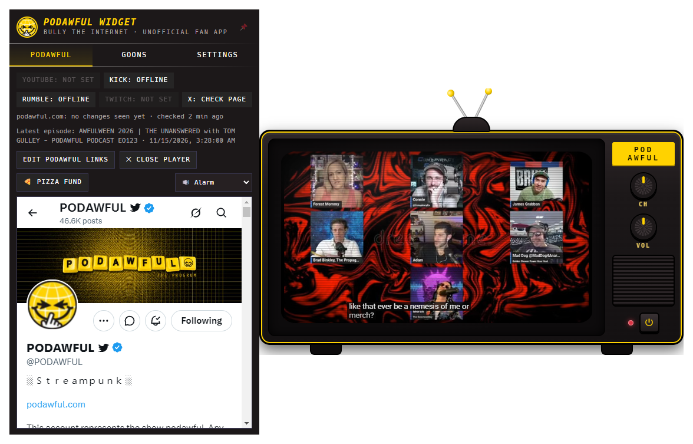
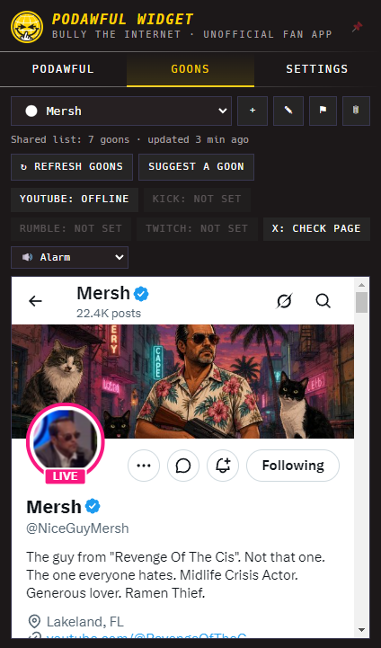
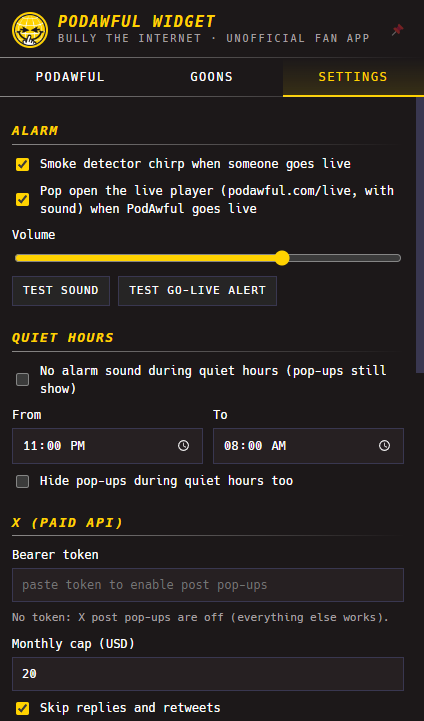

# PodAwful Widget

**Unofficial, fan-made.** Not affiliated with or endorsed by PodAwful.

A little Windows tray app for PodAwful fans. It tells you the second PodAwful or any of the goons goes live, and when Jesse goes live a retro TV slides out of the widget and starts playing the stream.



## What it does

### 📺 Live TV player
- When PodAwful goes live, the widget pops up and **a retro TV slides out of its side** and plays [podawful.com/live](https://podawful.com/live) with sound. It only does this once per stream; turn it off in Settings.
- Press **▶ Watch live** any time to open it yourself, and **✕ Close player** to put it away.
- The knobs work: **CH** reloads the stream, **VOL** mutes, **⏻** switches it off (with the old CRT shut-off). Right-click the screen to sign in to podawful.com, so member streams play too.
- The TV follows the widget around, and slides out of the left side instead if the widget is against the right edge of your screen.
- During quiet hours it still comes on, but muted.

### 🔴 Go-live alerts
- A pop-up and a **smoke-detector low-battery chirp** when PodAwful or any goon goes live on **YouTube, Kick, Rumble, Twitch or podawful.com**. Click the pop-up to watch.
- A **LIVE NOW** strip at the top shows everyone who's live right now. The tray icon gets a red dot too.
- Set each person to **🔊 Alarm**, **💬 Pop-up only** or **🔕 Muted**.
- **Quiet hours:** no chirp overnight (and optionally no pop-ups).

### 🎙️ PodAwful tab
- Live status for each platform, plus PodAwful's X page right inside the widget.
- **New episode alerts** from the podcast feed, and a heads-up when anything else changes on podawful.com.
- **🍕 Pizza Fund** button straight to the [subscription page](https://podawful.com/levels).

### 👥 Goons tab
- Everyone shares one goon list, kept in this repo and updated automatically (see [The shared goon list](#the-shared-goon-list)). **Suggest a goon** right from the app.
- Each goon's live status and X page, with their own alert level.
- Add your own private goons, or hide shared ones you don't care about.

### ⚙️ And
- **Updates itself:** new versions download in the background and install when you restart it.
- Optional pop-ups for new X posts (needs your own paid X API key, see below).
- Links open in Opera if you have it, otherwise your default browser. Can start with Windows.

<p>
  
  
</p>

## Install

1. Download `PodAwful Widget Setup x.y.z.exe` from the [Releases](https://github.com/Canti1/podawful-widget/releases) page.
2. Run it. The installer isn't code-signed, so Windows SmartScreen will say **"Windows protected your PC"**. Click **More info**, then **Run anyway**.
3. The widget lives in the system tray (bottom-right, near the clock). Click the icon to open it.

**Tip:** the embedded X page starts in light mode. Log in to X inside the widget and pick *Settings → Accessibility, display and languages → Display → Lights out*.

## The shared goon list

Everyone's widget downloads the goon list from [`goons.json`](goons.json) in this repo when it starts and every 6 hours. You can also press **↻ Refresh goons**. When the list changes you'll see "Goon list updated: N new, N closed".

- **Suggest a goon:** this is how you can help! Press **Suggest a goon** (or tick "Also suggest them" when adding one). It opens a pre-filled GitHub issue. You need a free GitHub account.
- **Account closed / suspended / wrong links:** select the goon and press **⚑**.
- Suggestions go live for everyone once the maintainer approves them.
- **Your own goons:** goons you add with **＋** stay on your PC only. Shared goons can be hidden with 🗑 (undo in Settings).

Each goon has a status: `active`, `suspended` (still checked, but marked), or `closed` (no longer checked).

### For the maintainer: approving suggestions

New suggestions are checked automatically when they're opened: duplicates are closed, broken ones get **`needs-fix`** (and are re-checked when edited), valid ones get **`ready-for-review`**. More than 3 suggestions from one account in a day are closed as **`possible-spam`**, and accounts under a week old get a **`new-account`** label.

To approve, add the **`approved`** label to a suggestion or report issue. A GitHub Action checks it (valid handles, no duplicates), updates `goons.json`, commits, comments, and closes the issue. If something's wrong it comments why and removes the label, so you can fix the issue text and label it again. You can also edit `goons.json` by hand; the Tests workflow checks it on every push.

## X post pop-ups (optional)

X charges for API access, so post pop-ups are off unless you paste your own bearer token in Settings. There's a monthly spend cap so it can't run up a bill. Everything else works without it.

## Development

```
npm install
npm start      # run it
npm test       # unit tests
npm run dist   # build the Windows installer into dist/
```

Fonts: [Hack](https://github.com/source-foundry/Hack) (MIT, see `assets/fonts/LICENSE.md`).
